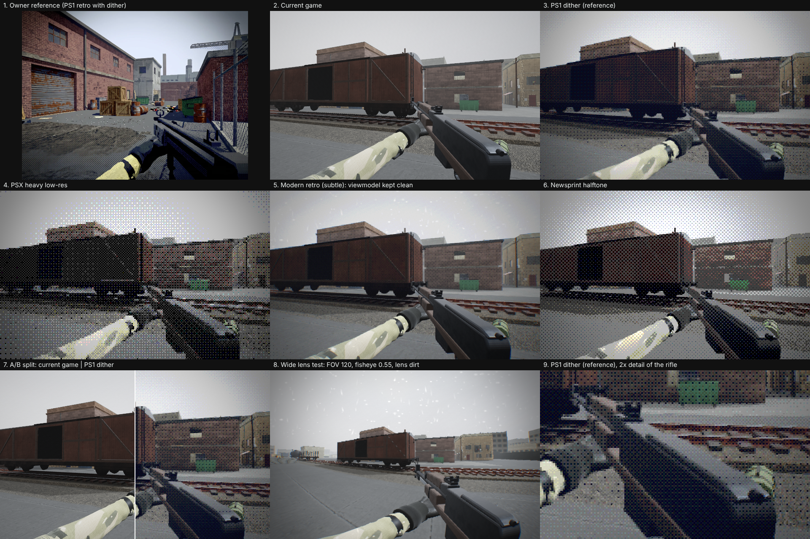

# L0 art style lab

A sandbox for finding the game's look by turning dials live. It loads the Claudov map **empty** (no Wardens, no Scavengers, no other
players, no lobby, no raid clock), puts you in first person with the free SKS (the viewmodel matters to the style), and adds one
post-processing pass after the engine's own. Normal play never gets that pass.



`contact-sheet.png`: the owner's reference, then each preset from the same view of Claudov, the A/B split, high FOV with fisheye, and a
2x detail. `reference-ps1-dither.webp` is the owner's own screenshot that set the first target.

## Opening it

Add `#artlab` to the game's address and load it:

- beta site: `/beta/#artlab` (for example `https://vincentdn.github.io/escape-from-claudov/beta/#artlab`)
- live site: `https://vincentdn.github.io/escape-from-claudov/#artlab`
- local build: `dist/index.html#artlab`

Typing `#artlab` onto an address that is already open also works: the page reloads into the lab. The main menu has no button for it yet,
because the menu files belong to the UI package (see "For the lead" below).

Once Claudov is loaded, click the scene to take the mouse, then walk and look around as usual.

- **F2** opens and closes the dial panel (the **Art lab (F2)** button in the bottom-left corner opens it too). Opening it frees the mouse
  without pausing. **Escape** or a click on the scene closes it.
- **Leave the lab** (at the bottom of the panel) reloads the normal game with your own field of view and map.

The lab always uses the free SKS kit, so your stored loadout is never put at risk. Your "free kit" choice in the hideout is put back as
soon as the kit is handed out.

## Presets

| Preset | What it is |
| --- | --- |
| Current game | Every effect off. Pixel-identical to the game (checked by the test, see below). |
| PS1 dither (reference) | The owner's reference: half resolution, nearest texels, 14 levels per channel with a 4x4 Bayer dither in 2-pixel cells, shadows dotted towards navy, light vertex snapping, a little bulge, haze, vignette and grain. |
| PSX heavy low-res | Much lower resolution, 6 levels, heavy snapping, close fog. |
| Modern retro (subtle) | Light posterising with a fine 8x8 dither, lens dirt and streak, and the viewmodel kept clean. |
| Newsprint halftone | A 45-degree halftone dot screen, 5 levels, desaturated. |
| Wide lens test (120 degrees) | FOV 120 with a strong fisheye and lens dirt, to judge wide FOV and edge distortion together. |

Pick one in the list and press **Apply preset**. Changing any dial afterwards changes only that dial.

## The dials

### Retro / PS1

| Dial | What it does |
| --- | --- |
| Internal resolution | The share of the screen resolution the image is sampled at, then blown up with nearest-neighbour (pixelation). 1 = off. |
| Colour levels per channel | Posterisation. 256 = off; 8 to 16 gives the PS1 banding. |
| Dither pattern | off, Bayer 2x2, 4x4 or 8x8, or a halftone dot screen. The pattern breaks up the posterised bands and draws the shadow-tint dots. |
| Dither strength | 0 = plain banding, 1 = full dither. The dither is weaker in the highlights on purpose, so skies stay calmer than shadows and midtones. |
| Dither cell (screen px) | The size of one dither cell in screen pixels. For halftone, the dot pitch is three cells. Match it to the internal resolution (cell 2 at resolution 0.5) for a clean grid. |
| Shadow tint colour / amount | Dark areas go towards this colour instead of black. With a dither pattern on, they become dots of the colour, denser the darker the area (the navy dots on the gun and gloves in the reference). |
| Texture filtering | `game` = the engine's own (linear, mipmaps, anisotropy); `nearest` = chunky texels. |
| PS1 vertex snapping | Rounds every vertex to a coarse screen grid (480 rows at the low end, 48 at 1). It makes edges wobble when you move. |
| Viewmodel gets the retro effect | Off keeps the rifle and hands out of pixelation, posterising, dither, tint and snapping. The lens and colour dials still apply to them. |

Affine texture warping (the PS1's wobbly textures) is **not** in the lab. WebGL 2 has no way to switch off perspective correction per
varying, so it would mean rewriting the texture coordinates of every engine material. That is more than a cheap dial.

### Lens

| Dial | What it does |
| --- | --- |
| Bloom strength / threshold / radius | The engine's own bloom pass. At Low and Minimal quality the game has bloom off; moving one of these dials (or using the dirty lens or streak) turns it on in the lab. |
| Dirty lens | A procedural texture of specks, smudges and short rain-like streaks, lit only where bright light and bloom reach it. |
| Spectral streak | A short horizontal rainbow band where strong light grazes the lens, after the owner's second reference (`docs/lens/`). It needs a bright light in view: Claudov's overcast sky is not bright enough to show it, so it does not appear in the contact sheet. |
| Fisheye / barrel | Bulges the centre and squeezes the edges, without black corners. |
| Field of view | 40 to 120 degrees (the game's own option stops at 80). Combine it with the fisheye to judge high FOV. |
| Chromatic aberration | Red and blue fringes that grow towards the edges. |
| Vignette | Darkens the corners. |
| Film grain | Animated noise. |

### Colour

| Dial | What it does |
| --- | --- |
| Exposure | Brightness, applied in linear light. |
| Contrast / Saturation | Applied to the finished image. |
| Fog colour | The map's fog colour. |
| Fog half distance (m) | The distance at which the fog hides half of the scene. Claudov's own value is about 75 m. |

### Comparing

**A/B split** shows the current game on the left half and the styled image on the right, with a white line between them. It compares the
post-processing only. The dials that change the scene itself (field of view, fog, bloom, texture filtering and vertex snapping) apply to
both halves.

**Hide the HUD** hides the raid HUD for clean comparisons.

## Sending the settings back

Your dials are saved in the browser (`localStorage`, key `efc_artlab_v1`) and come back the next time you open the lab.

To send a look you like:

1. Press **Copy settings**. The settings go to the clipboard as JSON. If the browser blocks the clipboard, the JSON appears selected in a
   box instead: copy it with Ctrl+C.
2. Paste that JSON into a message or an issue. A later task can make it the game's default.

To load settings someone sent you, press **Paste settings**. If the browser does not allow reading the clipboard, a box opens: paste the
JSON there and press **Import**. Values outside a dial's range are clamped, unknown values fall back to the default, and anything that is
not lab settings is refused without changing your dials.

The JSON looks like this (fog and bloom values are absolute: they are the map's own values unless you moved them):

```json
{ "efcArtlab": 1, "settings": { "scale": 0.5, "levels": 14, "dither": "bayer4", "ditherStrength": 1, "ditherCell": 2, "tint": "#2b3a78", "tintAmount": 0.55, "...": "..." } }
```

## Checks

`node tools/dev/efc/test-artlab.mjs`, after `python3 build.py`, checks that:

- `#artlab` boots Claudov in a live raid with no Wardens or Scavengers alive or able to spawn, offline, a day on the clock, the free SKS
  in hand, the stash's free-kit choice restored, and the lab pass last in the chain
- F2 opens and closes the panel, the corner button opens it, Escape closes it, and the match never pauses
- every one of the 25 dials changes a shader uniform or the engine value it drives (bloom pass, fog, FOV, snap uniform, texture filters),
  and a slider in the panel reaches its uniform
- "Current game" is pixel-identical to the lab being off (0 of 255 difference on every pixel), and the pass forced on with neutral dials
  differs by at most 1/255 (half-float rounding)
- settings round-trip through Copy and Paste (clipboard or the fallback box), the JSON functions and localStorage; bad JSON is refused and
  bad values are clamped
- the A/B split turns the pass on and off
- a normal raid keeps the engine's chain unchanged (no lab pass, no patched material, no changed texture, no panel) and has its Wardens

`node tools/dev/efc/artlab-contact-sheet.mjs` rebuilds `contact-sheet.png`.

## What a still frame cannot show

- **Motion.** Dither patterns are fixed to the screen, so they crawl over moving surfaces. Pixelation shimmers on thin lines as you turn.
  Neither shows in a still frame. Judge them by walking around.
- **Vertex snapping.** In a still frame it only looks like slightly bent edges. The PS1 feel is the wobble while you move, and that has
  to be seen live.
- **Real GPU cost.** Every capture here comes from a software renderer (about five seconds a frame), so the numbers say nothing about a
  real graphics card. The pass is one full-screen draw with a few texture reads, plus up to 12 bloom reads when the spectral streak is
  on, and one extra draw of the viewmodel when it is kept out of the retro stage. Turning on vertex snapping recompiles every material once
  (expect a short hitch the first time). Use `#bench` on a real machine if the look is adopted.
- **The spectral streak**, which needs a strong light Claudov does not have.

## For the lead

- **No engine hook.** The lab starts itself once the game has booted, with the `#artlab` hash. It appends its pass to the composer at
  runtime and keeps it last on every frame, so a rebuilt composer gets it back. It takes all bots out of play on `raid:placed`, after the
  Warden and Scavenger packages have placed theirs.
- **Menu entry.** A main-menu button needs the UI package (`src/efc/50-efc-ui-menu.js`). It only has to navigate to `#artlab`; the lab
  reloads into itself.
- **Field of view.** The lab drives `Settings.fov` and puts your own value back when you leave or close the tab. If the browser is
  killed while the lab is open, the lab's FOV can stay saved; set it again in Options.
- **Render resolution.** When the quality's render resolution is lower than the screen's, the engine's final pass normally does the
  upscaling (EASU). With the lab pass on, the final pass writes at render resolution and the lab pass upscales with plain filtering. "Current
  game" turns the pass off, so the game's own image is unaffected.
