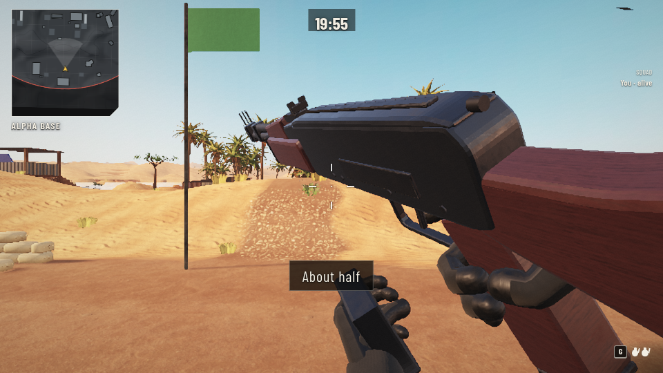
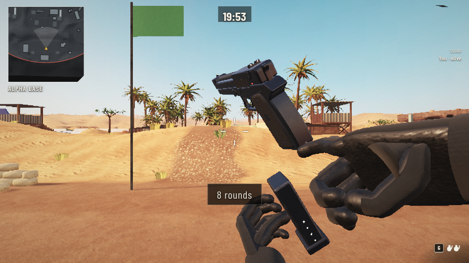
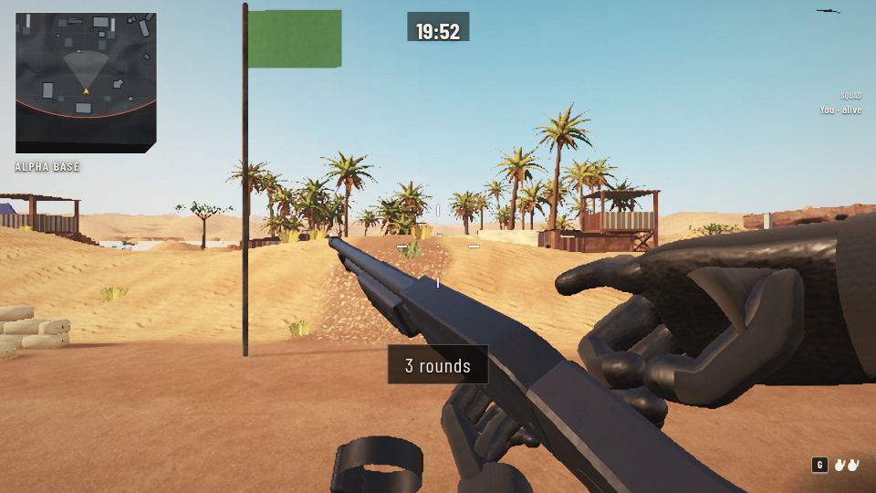

# Raid HUD

**Minimal raid HUD** is enabled by default under **Settings → Game → Interface**. It hides the weapon name, magazine pips, loaded rounds and reserve rounds. The raid still shows the crosshair, hit markers, damage direction, health and treatment, grenades, timer, squad status, minimap and interaction prompts. The extracts list appears when extraction is in progress or the tactical map is open. Disable Minimal raid HUD to restore the full display.

Tap the bound Reload key, **R** by default, to reload. Hold it for about 0.30 seconds to check the loaded ammunition. The player lifts a detachable magazine or looks into the action on a fixed magazine or tube. Release to put the weapon back into its ready position. Firing, aiming down sights, sprinting, switching weapons or opening an inventory panel interrupts the check.

**Magazine check readout** defaults to **Rough**. It uses fill descriptions such as *About half* and displays exact counts for small pistol magazines, the SKS and tube magazines. **Exact** shows the loaded round count for every check. The raid tracks a single loaded count per weapon. Reserve ammunition is available in the raid inventory, and other players see the check in third person.

| Rifle | Pistol | Pump shotgun |
| --- | --- | --- |
|  |  |  |
